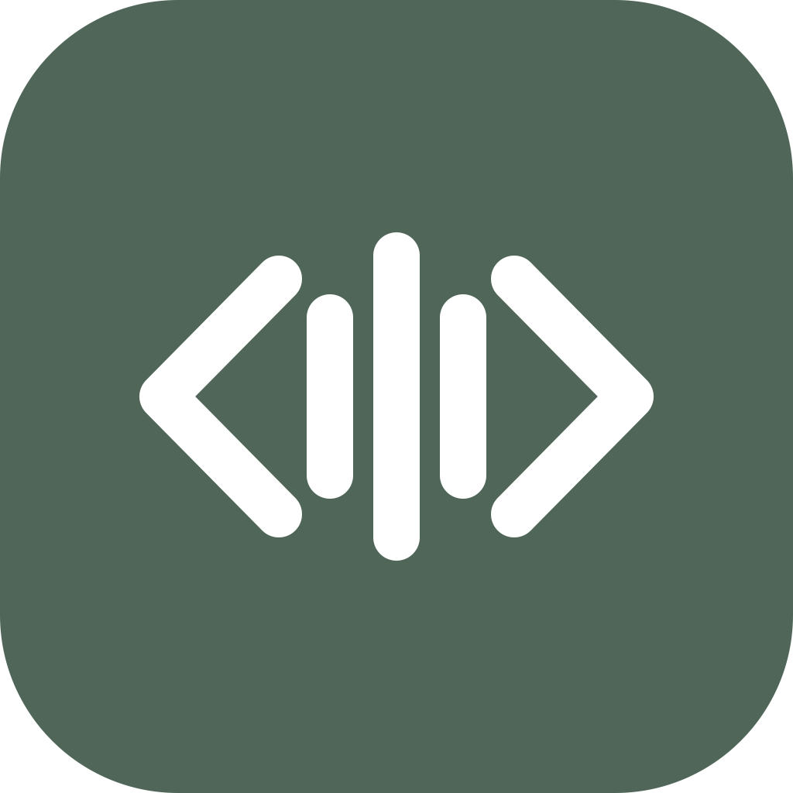

<p align="center">
  
</p>

<h1 align="center">Dicty</h1>

<p align="center">
  <b>Fast, private AI voice dictation for developers and professionals.</b><br>
  Sub-300ms latency · 100% offline on Apple Silicon and Metal · Zero subscriptions required.
</p>

<p align="center">
  <a href="https://github.com/dicty-io/dicty/releases/latest"></a>
  
  
  
  
  <a href="LICENSE"></a>
</p>

---

## Overview

Dicty is an open-source, local-first voice dictation application designed for developers, writers, and technical professionals.

Commercial alternatives frequently gate basic functionality behind paid subscriptions ($10–$20/month) or stream raw microphone audio to third-party cloud APIs. Dicty executes speech inference locally using an embedded, pre-warmed C++ `whisper.cpp` server accelerated by Metal GPU in RAM. Spoken input is transcribed, normalized, and inserted directly into the active application in **under 300 ms**.

Whether authoring comments in Cursor, answering Slack messages, drafting documentation, or recording meetings, Dicty delivers context-aware dictation with zero cloud dependency.

---

## Core Capabilities

* **Sub-300ms Latency**: A persistent local `whisper-server` process remains resident in RAM on a dedicated loopback port, avoiding per-utterance model initialization overhead.
* **100% Offline and Private**: Operates entirely air-gapped without an internet connection. Audio never leaves the local machine unless external cloud providers are explicitly configured.
* **Zero-Knowledge Telemetry**: Telemetry is strictly opt-in and disabled by default. Dicty never collects transcripts, audio recordings, user emails, or active application identifiers ([Telemetry Policy](docs/telemetry.md)).
* **Active Window Context Awareness**: Inspects the frontmost application to adapt syntax and tone:
  * **Slack / Discord**: Short paragraphs and conversational format.
  * **Cursor / VS Code / Xcode**: Code comments, identifiers (`parseUserToken`), docstrings.
  * **Mail / Notes**: Structured paragraphs, formal greetings, and standard sign-offs.
* **Native Double-Tap Shortcuts**: Triggers immediately using double taps on modifier keys: `2× Fn`, `2× Option`, `2× Command`, or `2× Shift` (with hardware debounce and push-to-talk support).
* **Clipboard Preservation**: Injects text via synthetic keystrokes (`CGEvent`) and automatically restores the user's prior pasteboard state without corrupting existing copied content.
* **Deterministic Snippets and Vocabulary**: Spoken phrase triggers (e.g. *"my email"*) expand into custom snippet values (`john@example.com`) in ~0ms before optional LLM formatting stages.
* **Incognito Mode**: In-memory ephemeral dictation processed strictly in volatile RAM, with zero disk caching or history database writes.
* **Media Playback Handling**: Automatically pauses or ducks media playback (Spotify, Apple Music, YouTube) when dictation begins and restores state upon release.
* **Meeting Transcription**: Captures microphone and system loopback audio simultaneously with speaker separation and action-item generation.

---

## Installation

### macOS

#### 1. Download DMG
1. Download the latest **[Dicty.dmg](https://github.com/dicty-io/dicty/releases/latest)** from GitHub Releases.
2. Open the disk image and drag **Dicty.app** into `/Applications`.
3. Launch Dicty from Applications or Spotlight.

#### 2. System Permissions
Because Dicty captures microphone audio and automatically pastes text into your focused application, macOS requires two permissions:
* **Microphone**: Grants audio capture for speech recognition.
* **Accessibility**: Allows global hotkey detection and synthetic keystroke paste (`Cmd+V`) into active apps.

When prompted on first launch, grant both permissions in **System Settings → Privacy & Security**.

> **Note on Gatekeeper**: For ad-hoc open-source builds, if macOS displays an untrusted developer warning on initial launch, click **Open Anyway** in **System Settings → Privacy & Security**, or run:
> ```bash
> xattr -cr /Applications/Dicty.app
> ```

#### 3. Verifying Checksums
Every GitHub Release publishes a corresponding `.sha256` checksum file (e.g. `Dicty.dmg.sha256`). To verify integrity:
```bash
shasum -a 256 -c Dicty.dmg.sha256
```

---

### Windows

#### 1. Standalone Installer
1. Download the latest **`Dicty_<version>_x64-setup.exe`** from **[Releases](https://github.com/dicty-io/dicty/releases/latest)**.
2. Run the installer. It installs Dicty to `%LOCALAPPDATA%\Programs\Dicty`.
3. Launch Dicty from the Start Menu or Desktop shortcut.

The Windows package is fully self-contained. It bundles the backend engine, speech recognition runtime, and optional NVIDIA CUDA GPU acceleration. No Python, Node.js, or external runtimes are required.

#### 2. Verifying Checksums
Verify the installer integrity against its published `.sha256` file in PowerShell:
```powershell
Get-FileHash .\Dicty_*_x64-setup.exe -Algorithm SHA256
```

---

## Architecture

Dicty operates as three decoupled local processes for stability, low latency, and process isolation:

```text
┌────────────────────────────────┐
│   Dicty.app (Swift / SwiftUI)  │  UI, Global Hotkeys, CoreAudio recording,
│   Menu Bar & Floating HUD      │  Keystroke injection (paste), Media ducking
└───────────────┬────────────────┘
                │ HTTP / WebSockets (localhost:8075)
┌───────────────▼────────────────┐
│   Dicty Engine (Python FastAPI)│  Pipeline orchestration, Vocabulary normalization,
│   dicty_engine.py              │  Snippets (⟦S1⟧), App rules, History (SQLite WAL)
└───────────────┬────────────────┘
                │ IPC (random localhost port)
┌───────────────▼────────────────┐
│   whisper-server (whisper.cpp) │  C++ Metal GPU server kept warm in RAM (~240ms STT).
│   Apple Silicon Acceleration   │  Crash-isolated: restarts automatically on model switch.
└────────────────────────────────┘
```

---

## Building from Source

### macOS

#### Prerequisites
- macOS 14.0+ (Sonoma or Sequoia)
- Xcode 15+ (or Command Line Tools)
- Python 3.11+
- CMake and Ninja (`brew install cmake ninja`)

#### Build and Run
```bash
# 1. Clone repository
git clone https://github.com/vkazmin1/dicty.git
cd dicty

# 2. Setup Python backend
python3 -m venv .venv
source .venv/bin/activate
pip install -r requirements.txt

# 3. Compile local whisper.cpp Metal server
./scripts/compile_whisper.sh

# 4. Terminal 1: Launch backend engine
python dicty_engine.py

# 5. Terminal 2: Launch Swift client
cd DictyClient
swift run
```

---

### Windows

#### Prerequisites
- Windows 10 or 11 (64-bit)
- Python 3.10 – 3.13
- Node.js 18+ and npm
- Rust toolchain (optional, only required if compiling the native Tauri desktop shell)

#### Build and Run
```cmd
:: 1. Automated environment setup
scripts\windows\setup_windows.bat

:: 2. Run in development mode (Native desktop app)
scripts\windows\run_dev.bat

:: Or run via web browser interface (no Rust required)
scripts\windows\run_dev_web.bat
```

For full Windows development details, packaging, and CUDA configuration, see the **[Windows Setup Guide](docs/architecture/windows_how_to_run_locally.md)**.

---

## Testing

```bash
# Run Python backend test suite (330+ tests)
.venv/bin/python3 -m unittest discover tests -p "test_*.py"

# Run Swift client test suite (34 tests)
cd DictyClient
swift test
```

---

## Documentation

* **[Contributing Guide](CONTRIBUTING.md)**: Architecture lifecycle, SwiftUI performance rules, and code guidelines.
* **[Telemetry and Privacy Policy](docs/telemetry.md)**: Opt-in telemetry specification and zero-PII guarantees.
* **[Architecture Decision Records](docs/architecture/architecture_decisions.md)**: Design choices and security boundaries.
* **[Windows Setup Guide](docs/architecture/windows_how_to_run_locally.md)**: Running Dicty on Windows via Tauri v2.
* **[Features Matrix](docs/features_matrix.md)**: Detailed feature breakdown across modes and platforms.

---

## License

Dicty is licensed under the **[MIT License](LICENSE)**.
