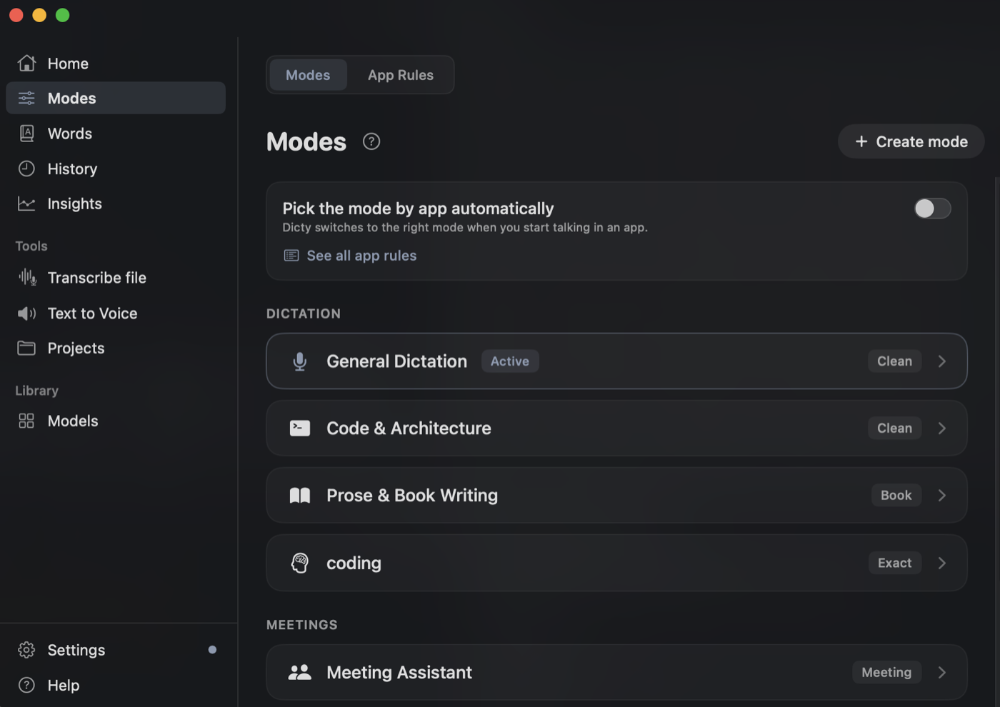
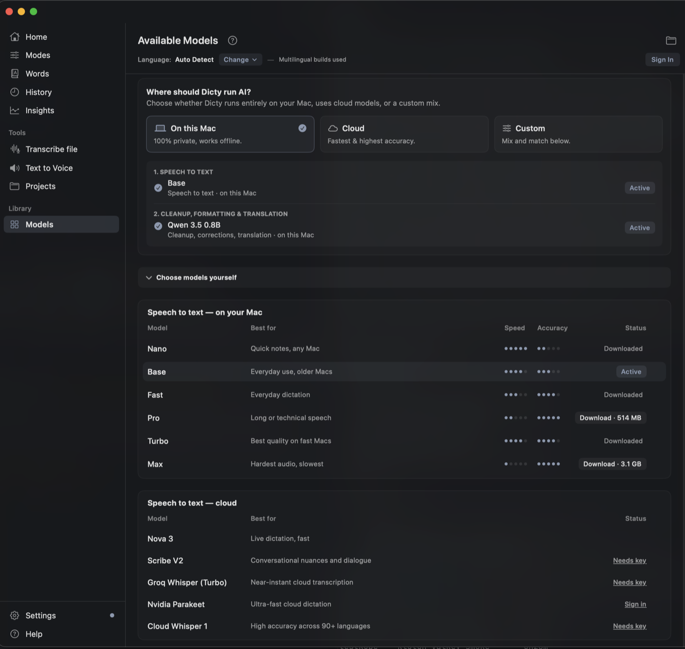
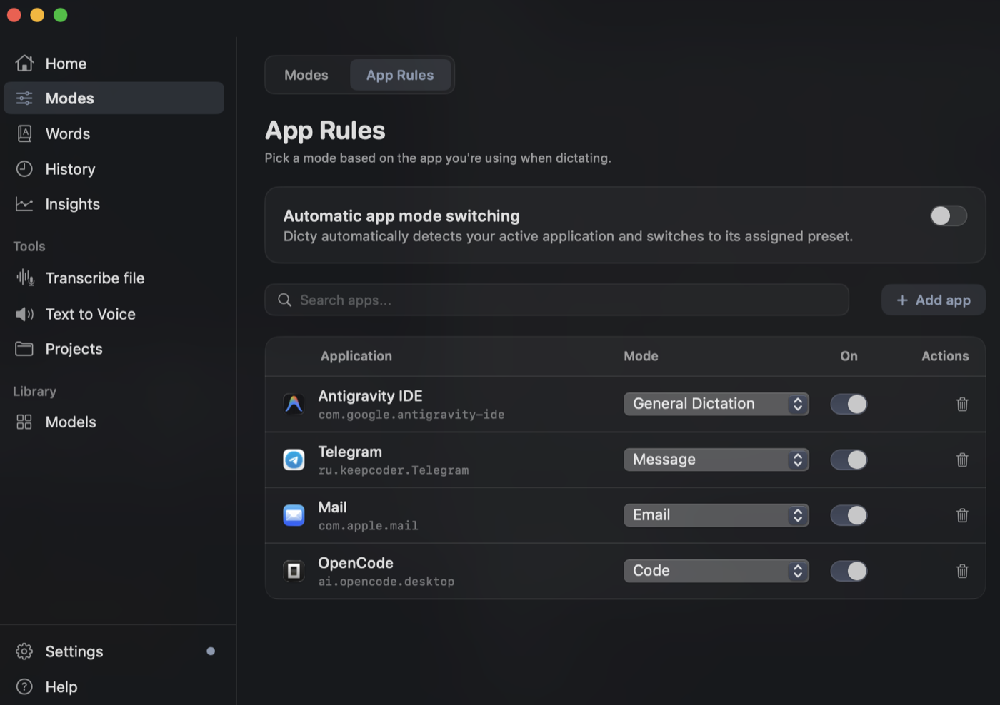
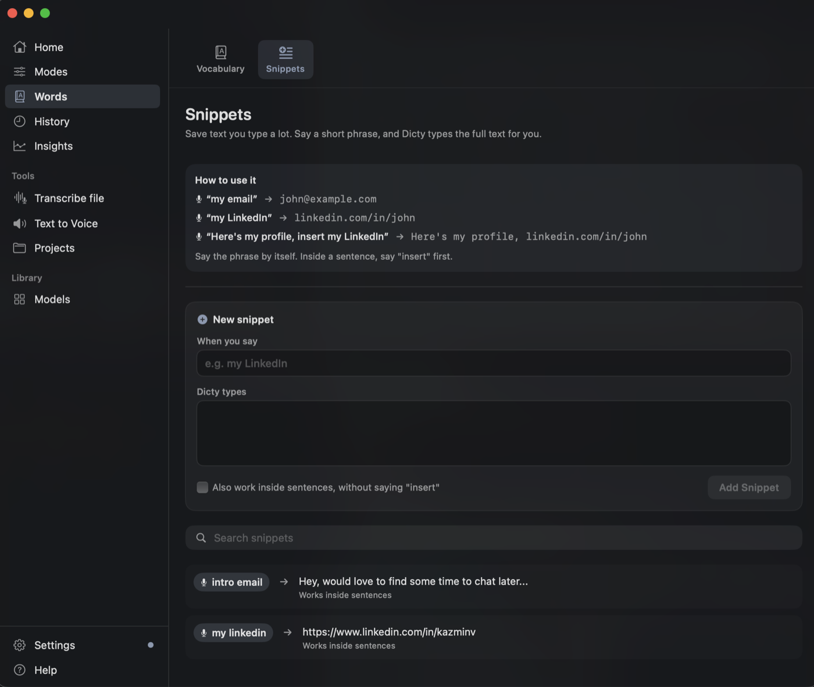
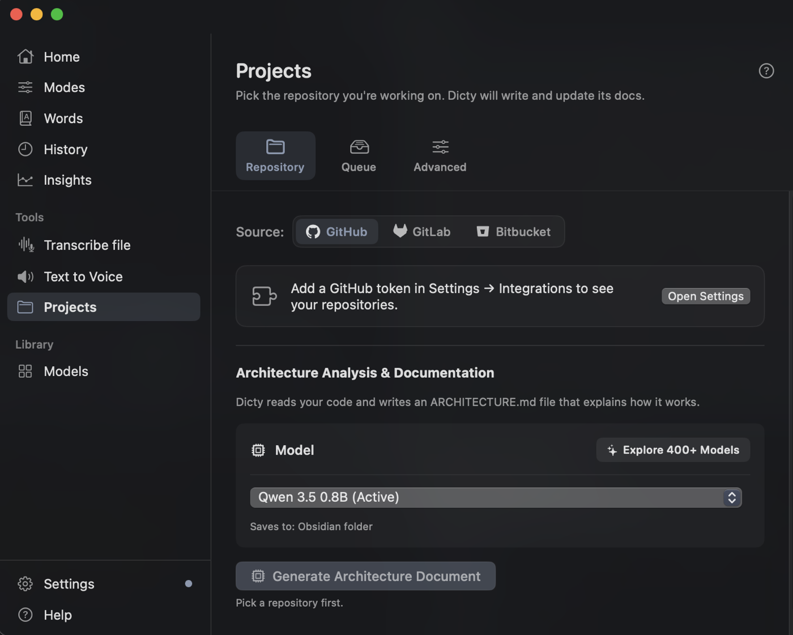
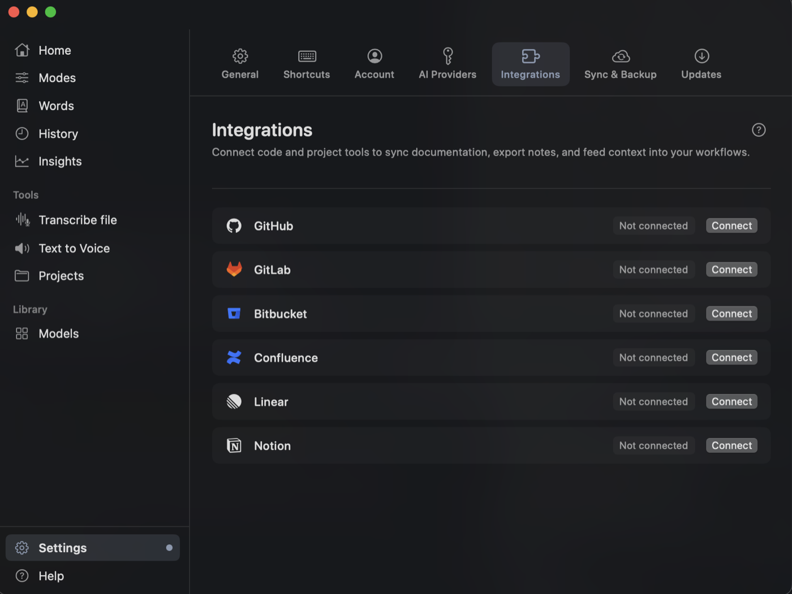
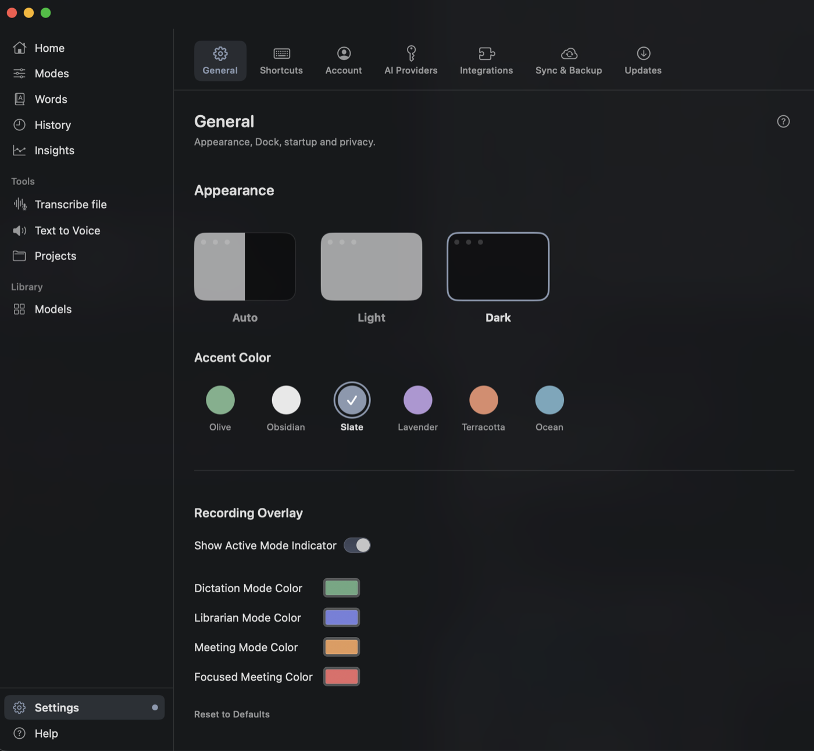

<p align="center">
  
</p>

<h1 align="center">Dicty</h1>

<p align="center">
  <b>Fast, private AI voice dictation for developers and professionals.</b><br>
  Sub-300ms latency · Offline by default, cloud optional · Zero subscriptions required.
</p>

<p align="center">
  <a href="https://github.com/dicty-io/dicty/actions/workflows/tests-and-build.yml"></a>
  <a href="https://github.com/dicty-io/dicty/releases/latest"></a>
  
  
  
  
  <a href="LICENSE"></a>
</p>

<p align="center">
  <a href="https://dicty.io">Homepage</a> &nbsp;|&nbsp;
  <a href="https://dicty.io/docs/getting-started">Documentation</a>
</p>

---

## Overview

Dicty is an open-source, local-first voice dictation app designed for developers, writers, and technical professionals.

Commercial alternatives gate basic functionality behind $10–$20/month subscriptions or send your microphone audio to third-party cloud servers. Dicty transcribes your voice directly on your device using a pre-warmed C++ `whisper.cpp` engine accelerated by Metal GPU in RAM. Spoken words are formatted for your current app and inserted right at your cursor in **under 300 ms**.

Whether authoring comments in Cursor, answering Slack messages, drafting documentation, or recording meetings, Dicty delivers context-aware dictation with zero cloud dependency.

---

## Why Dicty?

| Feature | Dicty | Wispr Flow | Superwhisper | macOS Dictation |
|:---|:---:|:---:|:---:|:---:|
| **Price** | **Free & Open Source** | $12–$16 / month | $8–$14 / mo or $199 lifetime | Free with macOS |
| **Offline by Default** | ✅ 100% on-device Metal | ❌ Cloud only | ✅ Local or cloud | ⚠️ Partial (basic STT only) |
| **End-to-End Latency** | **< 300 ms** | ~600–1,200 ms | ~400–800 ms | ~400–700 ms |
| **Developer Context (IDEs)** | ✅ camelCase, snake_case | ✅ Supported | ⚠️ Manual prompts | ❌ None |
| **Custom Snippets & Words** | ✅ Instant (0 ms) | ✅ Cloud sync | ✅ Local | ❌ Basic text replacement |
| **Meeting Audio (Mic + Loopback)** | ✅ Dual-track separated | ❌ Mic only | ❌ Mic only | ❌ Mic only |
| **Zero Data Retention** | ✅ Ephemeral in-memory | ❌ Cloud processed | ⚠️ Local-first | ⚠️ Apple servers |

---

## Quick Start in 60 Seconds

1. **Install Dicty** via Homebrew:
   ```bash
   brew install --cask dicty-io/dicty/dicty
   ```
   *(Or download the latest disk image from **[Releases](https://github.com/dicty-io/dicty/releases/latest)**)*.
2. **Launch Dicty** and grant **Microphone** and **Accessibility** permissions when prompted.
3. **Double-tap `Fn`** (or press your configured global shortcut), speak naturally, and watch your words appear instantly in your active app.

---

## Real-World Latency: Backed by Numbers

We measure **end-to-end latency** from the exact moment speech stops to the moment text appears in your frontmost application:

| Hardware | STT Model | p50 Latency | p95 Latency | Memory Footprint |
|:---|:---|:---:|:---:|:---:|
| **Apple M2 (16 GB)** | `base.en` (Metal GPU) | **240 ms** | **310 ms** | ~280 MB RAM |
| **Apple M3 Pro (18 GB)** | `base.en` (Metal GPU) | **215 ms** | **285 ms** | ~280 MB RAM |
| **Apple M1 (8 GB)** | `base.en` (Metal GPU) | **265 ms** | **340 ms** | ~280 MB RAM |
| **Apple M2 / M3** | `small.en` (Metal GPU) | **380 ms** | **490 ms** | ~620 MB RAM |

### Reproduce Benchmarks on Your Mac

Dicty logs millisecond timing breakdowns directly to the unified macOS system log:
```bash
# Stream live stop-to-paste latency metrics
/usr/bin/log stream --predicate 'subsystem == "com.kazmin.dicty"' --style compact
```
Or query historical performance breakdown directly via the local engine API:
```bash
curl http://127.0.0.1:8075/metrics/summary
```

---

## Core Capabilities

* **Under 300ms Latency**: The local speech engine stays warm in RAM, avoiding cold-start delays.
* **100% On-Device by Default**: Audio processing and transcription happen locally on your Mac's Metal GPU. Zero telemetry required ([Telemetry Policy](docs/telemetry.md)).
* **App-Aware Formatting**: Dicty senses where you are typing and formats accordingly:
  * **IDEs (Cursor, VS Code, Xcode)**: Identifiers (`camelCase`, `snake_case`), code comments, and docstrings.
  * **Chat (Slack, Discord)**: Natural conversational flow with proper punctuation.
  * **Email & Notes (Mail, Notion, Notes)**: Clean paragraphs, bullet points, and greetings.
* **Instant Snippets**: Say triggers like "my email" to insert predefined text templates instantly (0 ms overhead) without touching an LLM.
* **Safe Text Pasting**: Types text into the active window while leaving your existing clipboard contents intact.
* **Dual-Track Meetings**: Records your microphone and computer audio on separate channels for clear speaker separation.
* **Private Ephemeral Mode**: An in-memory mode that leaves zero trace of audio or transcripts on disk.

---

---

## Screenshots

A quick tour of the desktop preferences and mode customizer.

| Modes | Models |
|:---:|:---:|
| [](docs/pictures/modes.png) | [](docs/pictures/models.png) |
| **Modes** — one place for style, corrections, translation and meeting setup. | **Models** — run locally on Metal, in the cloud, or mix both. |
| [](docs/pictures/app-rules.png) | [](docs/pictures/snippets.png) |
| **App Rules** — let Dicty automatically format for each app. | **Words** — turn short spoken triggers into full snippets. |
| [](docs/pictures/projects.png) | [](docs/pictures/integrations.png) |
| **Projects** — turn a repository into architecture docs. | **Integrations** — GitHub, GitLab, Bitbucket, Confluence, Linear and Notion. |

<p align="center">
  <a href="docs/pictures/appearance.png"></a><br>
  <sub><b>Make it yours</b> — light, dark or auto, with customizable accent colors and per-mode floating overlays.</sub>
</p>

---

## Installation

### macOS

#### 1. Homebrew (Recommended)
```bash
brew install --cask dicty-io/dicty/dicty
```

#### 2. Download DMG
1. Download the latest **[Dicty.dmg](https://github.com/dicty-io/dicty/releases/latest)** from GitHub Releases.
2. Open the disk image and drag **Dicty.app** into `/Applications`.
3. Launch Dicty from Applications or Spotlight.

#### 3. System Permissions
Because Dicty captures microphone audio and automatically pastes text into your focused application, macOS requires two permissions:
* **Microphone**: Grants audio capture for speech recognition.
* **Accessibility**: Allows global hotkey detection and synthetic keystroke paste (`Cmd+V`) into active apps.

When prompted on first launch, grant both permissions in **System Settings → Privacy & Security**.

> **Note on Gatekeeper**: If macOS displays an untrusted developer warning ("Dicty cannot be opened because Apple cannot check it for malicious software") when launching a manually downloaded DMG, click **Open Anyway** in **System Settings → Privacy & Security**, or remove the quarantine attribute:
> ```bash
> xattr -cr /Applications/Dicty.app
> ```

#### 4. Verifying Checksums
Every GitHub Release publishes a corresponding `.sha256` checksum file (e.g. `Dicty.dmg.sha256`). To verify integrity:
```bash
shasum -a 256 -c Dicty.dmg.sha256
```

---

### Windows (Beta)

Pre-built Windows installer packages are currently in development. Windows is supported in **beta by building from source**:

1. Follow the **[Windows Build from Source](#windows-1)** steps below.
2. For complete configuration, Tauri frontend commands, and NVIDIA CUDA acceleration setup, consult the **[Windows Setup Guide](docs/architecture/windows_how_to_run_locally.md)**.

---

## Architecture

Dicty operates as three decoupled local processes for stability, low latency, and process isolation:

```text
┌────────────────────────────────┐
│   Dicty.app (Swift / SwiftUI)  │  UI, Global Hotkeys, CoreAudio recording,
│   Menu Bar & Floating HUD      │  Keystroke injection (paste), Media ducking
└───────────────┬────────────────┘
                │ HTTP / WebSockets (localhost:8075)
┌───────────────▼────────────────┐
│   Dicty Engine (Python FastAPI)│  Pipeline orchestration, Vocabulary normalization,
│   dicty_engine.py              │  Snippets (⟦S1⟧), App rules, History (SQLite WAL)
└───────────────┬────────────────┘
                │ IPC (random localhost port)
┌───────────────▼────────────────┐
│   whisper-server (whisper.cpp) │  C++ Metal GPU server kept warm in RAM (~240ms STT).
│   Apple Silicon Acceleration   │  Crash-isolated: restarts automatically on model switch.
└────────────────────────────────┘
```

---

## Building from Source

### macOS

#### Prerequisites
- macOS 14.0+ (Sonoma or Sequoia)
- Xcode 15+ (or Command Line Tools)
- Python 3.11+
- CMake and Ninja (`brew install cmake ninja`)

#### Build and Run
```bash
# 1. Clone repository
git clone https://github.com/dicty-io/dicty.git
cd dicty

# 2. Setup Python backend
python3 -m venv .venv
source .venv/bin/activate
pip install -r requirements.txt

# 3. Compile local whisper.cpp Metal server
./scripts/compile_whisper.sh

# 4. Terminal 1: Launch backend engine
python dicty_engine.py

# 5. Terminal 2: Launch Swift client
cd DictyClient
swift run
```

---

### Windows

#### Prerequisites
- Windows 10 or 11 (64-bit)
- Python 3.10 – 3.13
- Node.js 18+ and npm
- Rust toolchain (optional, only required if compiling the native Tauri desktop shell)

#### Build and Run
```cmd
:: 1. Automated environment setup
scripts\windows\setup_windows.bat

:: 2. Run in development mode (Native desktop app)
scripts\windows\run_dev.bat

:: Or run via web browser interface (no Rust required)
scripts\windows\run_dev_web.bat
```

For full Windows development details, packaging, and CUDA configuration, see the **[Windows Setup Guide](docs/architecture/windows_how_to_run_locally.md)**.

---

## Testing

```bash
# Run Python backend test suite (330+ tests)
.venv/bin/python3 -m unittest discover tests -p "test_*.py"

# Run Swift client test suite (34 tests)
cd DictyClient
swift test
```

---

## Documentation

* **[Documentation](https://dicty.io/docs/getting-started)**: Getting started, guides, and reference.
* **[Changelog](CHANGELOG.md)**: Release history, changes, and migration notes.
* **[Contributing Guide](CONTRIBUTING.md)**: Architecture lifecycle, SwiftUI performance rules, and code guidelines.
* **[Code of Conduct](CODE_OF_CONDUCT.md)**: Community standards and incident reporting.
* **[Telemetry and Privacy Policy](docs/telemetry.md)**: Opt-in telemetry specification and zero-PII guarantees.
* **[Architecture Decision Records](docs/architecture/architecture_decisions.md)**: Design choices and security boundaries.
* **[Windows Setup Guide](docs/architecture/windows_how_to_run_locally.md)**: Running Dicty on Windows via Tauri v2.
* **[Features Matrix](docs/features_matrix.md)**: Detailed feature breakdown across modes and platforms.

---

## Star History

[](https://star-history.com/#dicty-io/dicty&Date)

<p align="center">
  ⭐ <b>If Dicty saves you time, star the repo to support open-source voice computing!</b>
</p>

---

## License

Dicty is licensed under the **[MIT License](LICENSE)**.
